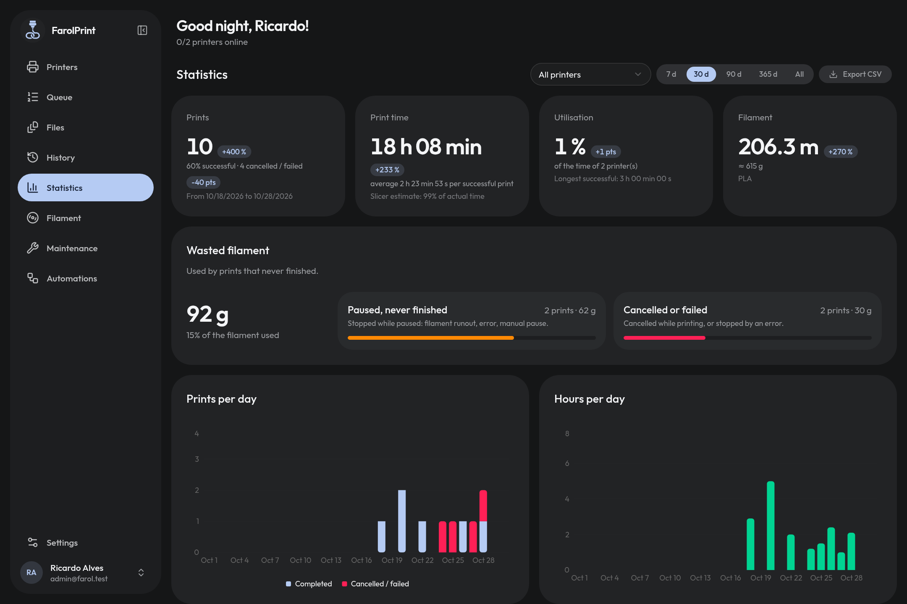

<p align="center"></p>

# FarolPrint

<p align="center">
  <a href="https://github.com/riccardoalv/farolprint/actions/workflows/docker-image.yml"></a>
  <a href="https://github.com/riccardoalv/farolprint/pkgs/container/farolprint"></a>
  <a href="https://github.com/riccardoalv/farolprint/stargazers"></a>
  <a href="LICENSE"></a>
</p>

> **Community fork.** FarolPrint started as Kobralink, created by [NatHacks](https://github.com/NatHacks/Kobralink).
> This fork continues its development for the community under its own name: bug fixes, Kobra 4 support, external
> spool tracking and the single-printer workflow. Issues and pull requests are welcome here. Existing installs keep
> working: the old `KOBRALINK_*` variables are still honoured and the database is renamed on first start.

FarolPrint turns an **Anycubic Kobra X** or **Kobra 4** into a **Moonraker-compatible printer** — no Klipper, no
Raspberry Pi, no firmware change. Run it on a small server with Docker, open the web dashboard, add your printer
by IP, then use it from **OrcaSlicer**, a **web dashboard** or any Moonraker client
(Mainsail, Obico, Home Assistant…).

<p align="center"></p>

## What you get

- **Multi-printer**: add a printer with its IP only, credentials are recovered automatically
- **Live state**: temperatures, fans, light, speed, progress, pause / resume / cancel, object skip
- **Print from anywhere**: web dashboard, OrcaSlicer (upload + print), per-printer print queue with bed-clear
  confirmation, scheduled starts
- **GCode library**: thumbnails, estimated time, filaments, per-printer file browser
- **AMS / ACE**: slot profiles, feeding, auto-feed, drying with scheduled cycles
- **Filaments**: spool inventory + optional Spoolman sync
- **Camera** (MJPEG, shared with Moonraker clients) and **timelapses** per job
- **AI failure detection** (optional, Obico model) with notify / pause / cancel
- **Notifications**: webhook, Discord, Telegram, ntfy · **Home Assistant** MQTT discovery
- **History & stats**: cost per print (filament, energy, machine time), CSV export, failures labelled with the
  camera snapshot of the moment
- **Preventive maintenance** per printer: tasks due by print hours, number of prints or days, with history
- **Macros**, backup / restore, update check, multi-user
- UI in **French**, **English**, **German**, **Spanish**, **Italian**, **Simplified Chinese** and
  **Brazilian Portuguese**

## Install in production (Docker Compose)

Requirements: Docker + Docker Compose, a machine on the same LAN as the printer. No clone needed:
`infra/docker-compose.prod.yml` runs the published image
[`ghcr.io/riccardoalv/farolprint`](https://github.com/riccardoalv/farolprint/pkgs/container/farolprint) (linux/amd64 + linux/arm64).

```bash
mkdir farolprint && cd farolprint
curl -fsSLO https://raw.githubusercontent.com/riccardoalv/farolprint/main/infra/docker-compose.prod.yml
curl -fsSL https://raw.githubusercontent.com/riccardoalv/farolprint/main/infra/.env.example -o .env
```

Edit `.env` and set `BETTER_AUTH_URL` to the URL you will type in the browser. Then:

```bash
docker compose -f docker-compose.prod.yml up -d
```

- Dashboard: `http://<host>:7100` — the first account created becomes the owner
- Moonraker: one port per printer, starting at `7125` (range `7125-7140` exposed, i.e. 16 printers)
- Data (SQLite, GCodes, timelapses, session secret) is kept in the `farolprint-data` volume

Update:

```bash
docker compose -f docker-compose.prod.yml pull && docker compose -f docker-compose.prod.yml up -d
```

To pin a version, set `FAROLPRINT_IMAGE=ghcr.io/riccardoalv/farolprint:<version>` in `.env`.

Behind a reverse proxy (HTTPS): set `FAROLPRINT_BIND=127.0.0.1` and
`BETTER_AUTH_URL=https://farolprint.example.com`. Moonraker ports stay direct (OrcaSlicer needs HTTP + WebSocket).
More details (backup, healthcheck, local build from source): [`infra/README.md`](infra/README.md).

More than 16 printers: the app assigns ports without limit (`7125`, `7126`, … up to `65535`), but the compose
file only publishes `7125-7140`. Printer 17+ would listen inside the container without being reachable from the host.
Widen the range in `docker-compose.prod.yml` (e.g. `"${FAROLPRINT_BIND:-0.0.0.0}:7125-7224:7125-7224"` for 100 printers),
or use `network_mode: host` on Linux and drop the `ports:` block entirely (then `FAROLPRINT_BIND` no longer applies and
every port listens on all interfaces).

### `.env` reference

| Variable                  | Default                     | Role                                                    |
| ------------------------- | --------------------------- | ------------------------------------------------------- |
| `FAROLPRINT_IMAGE`         | `ghcr.io/riccardoalv/farolprint:latest` | Image to run (pin a version or a commit: `ghcr.io/riccardoalv/farolprint:sha-<commit>`) |
| `FAROLPRINT_BIND`          | `0.0.0.0`                   | Host interface (`127.0.0.1` behind a reverse proxy)     |
| `FAROLPRINT_PORT`          | `7100`                      | Dashboard port on the host                              |
| `BETTER_AUTH_URL`         | —                           | **Required**: URL used by the browser                   |
| `BETTER_AUTH_SECRET`      | generated in `/data`        | Session secret (`openssl rand -base64 32`)              |
| `FAROLPRINT_EXTRA_ORIGINS` | —                           | Extra allowed origins, comma-separated                  |
| `FAROLPRINT_TRUSTED_PROXIES` | —                         | Proxy IPs/CIDRs (real client IP for auth rate limiting) |
| `FAROLPRINT_IP_HEADERS`    | —                           | Header set by the proxy with the client IP (`x-real-ip`, `cf-connecting-ip`) |

## Connect a printer

1. On the printer: Settings → **Enable LAN mode**.
2. Dashboard → **Add a printer** → enter the IP. A Moonraker port is assigned (`7125`, `7126`, …).
3. OrcaSlicer → physical printer → connection type **Moonraker** → host `http://<bridge-ip>:7125`
   (or open **Connect OrcaSlicer** in the dashboard: it lists the exact address to paste for each printer).
   Click *Test*, then confirm: the **Device** tab now shows the printer and *Print* sends the G-code to FarolPrint.

The OrcaSlicer **Device** tab only targets the printer: send a job, follow progress, pause / cancel, sync the ACE
filaments. Everything else — print queue, file library, macros, filament profiles per slot, camera, failure
detection, statistics, notifications, API keys — lives in the FarolPrint dashboard on `:7100`.

By default the Moonraker ports are **unauthenticated** (trusted LAN), like Moonraker itself. The dashboard
on `:7100` is protected by email + password.

To lock the Moonraker ports, open **OrcaSlicer → API keys** in the dashboard, enable *Require an API key*
and generate a key per printer and client — a key only unlocks the printer it was created for, so pasting
it in OrcaSlicer targets that printer. Clients send it as an `X-Api-Key` header (OrcaSlicer's "API Key / Password"
field, Fluidd, Obico, Home Assistant), as `Authorization: Bearer`, or as `?api_key=` in the URL (camera ``
tags). WebSocket clients can also use the standard Moonraker `/access/oneshot_token` flow. Mainsail has no
API key field and will not connect while the option is on.

## How it works

```
OrcaSlicer ──HTTP/WS──► :7125  (Moonraker, printer 1) ─┐
Mainsail / Obico ─────► :7126  (Moonraker, printer 2) ─┤   apps/api (single process)
Web UI ───────────────► :7100  (UI + /api/v1 API + auth)  ─┘         │ MQTT mTLS :9883
                                                                  ▼
                                                           Kobra X / Kobra 4 (LAN mode)
```

| App / package             | Role                                                                                      |
| ------------------------- | ----------------------------------------------------------------------------------------- |
| `apps/api`                | NestJS 11 · Prisma 7 + SQLite (libsql) · Better Auth (+ API keys) · MQTT bridge · Moonraker emulation |
| `apps/web`                | React 19 · Vite · TanStack Router + Query · Tailwind v4 · shadcn/ui                       |
| `packages/kobra-protocol` | Kobra LAN protocol: mTLS MQTT client, credential recovery, GCode upload / parsing           |
| `packages/shared`         | zod schemas + types shared between API and UI                                             |
| `packages/i18n`           | Paraglide (inlang) messages: `fr`, `en`, `de`, `es`, `it`, `zh-cn`, `pt-br`               |

## Documentation and contributing

- [Documentation](docs/README.md): [development](docs/development.md), [testing with your printer](docs/testing.md),
  [decisions](docs/decisions.md)
- [Contributing](CONTRIBUTING.md): Conventional Commits, squash-merged pull requests, tests with every change
- [Changelog](CHANGELOG.md)

Printer support is the most valuable contribution: open a
[printer support](https://github.com/riccardoalv/farolprint/issues/new?template=printer_support.yml) issue with your
model and anonymized MQTT messages.

## Development

```bash
bun install
bun run db:migrate   # creates data/farolprint.db
bun run dev          # API :7100 + Vite :5173 → http://localhost:5173
bun run dev:web      # same, with the Turborepo TUI

bun run build        # packages → api → web
bun run check-types
bun run test
bun run lint
```

API environment variables (`apps/api`):

| Variable                  | Default                               | Role                                          |
| ------------------------- | ------------------------------------- | --------------------------------------------- |
| `FAROLPRINT_DATA_DIR`      | `<repo>/data`                         | SQLite, `gcodes/`, timelapses, `.auth-secret` |
| `DATABASE_URL`            | `file:<data>/farolprint.db`            | libsql connection string                      |
| `FAROLPRINT_PORT`          | `7100`                                | UI + API                                      |
| `BETTER_AUTH_URL`         | `http://localhost:7100`               | Trusted origin / cookies                      |
| `BETTER_AUTH_SECRET`      | generated in `<data>/.auth-secret`    | Session secret                                |
| `FAROLPRINT_WEB_DIR`       | `apps/web/dist`                       | SPA build to serve                            |
| `FAROLPRINT_CERTS_DIR`     | `apps/api/certs`                      | `anycubic_slicer.crt` / `.key`                |
| `FAROLPRINT_EXTRA_ORIGINS` | `http://localhost:5173,…`             | Extra origins (CORS + Better Auth)            |
| `FAROLPRINT_FFMPEG`        | `@ffmpeg-installer/ffmpeg`, else PATH | ffmpeg binary for camera + timelapse          |
| `FAROLPRINT_VERSION`       | `package.json` version                | Version reported by `/api/v1/system`              |
| `FAROLPRINT_UPDATE_REPO`   | `riccardoalv/farolprint`               | GitHub repo polled for update checks          |

### Releases

Releases of this fork are made by release-please (see [Development](docs/development.md#commits-and-releases)): the
release PR bumps every version and the changelog, and merging it publishes the versioned image to GHCR.

## License

GPL-3.0. The `apps/api/certs/anycubic_slicer.*` certificates are third-party material included solely
for interoperability. They expire in 2123 (100 years), so no rotation is needed; they only have to be
replaced if an Anycubic firmware or slicer update ships a new certificate. If the MQTT TLS handshake is
refused by the printer, an outdated certificate is a likely cause. To pull a fresh pair from an Anycubic
Slicer Next install (`cloud_mqtt.dll` or the whole install directory), run
`bun run certs:extract <path> [--out apps/api/certs] [--force]`. Independent project, not affiliated
with Anycubic.
